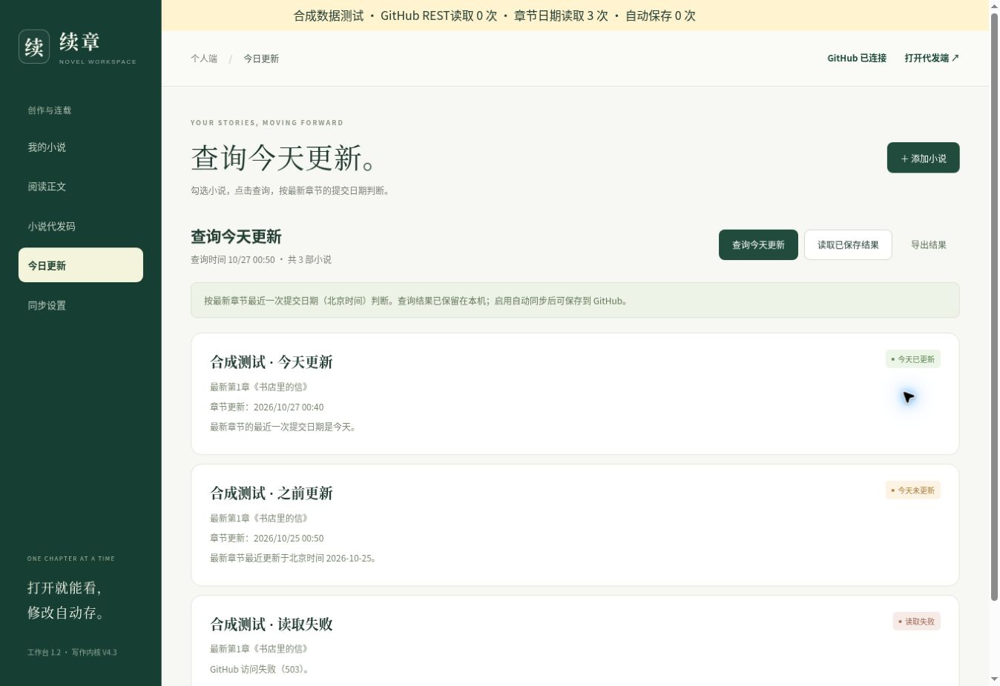

# 工作台1.2修复验证

本轮源代码基线：b4295413a25e81fa1307a16add09f971604e127f。验证时间：北京时间2026-10-27。仅修改软件、文档和管理查询观察，没有修改小说正文、写作状态或平台发布回执。

## 已复现的错误

原实现读不到不存在的 reports/latest.json 时，固定提交的公开原文返回404；备用REST通道受限后覆盖了原始404，导致“没有报告”被错误显示为“额度不足、正在使用备用通道”。把不含 books.json 的小说仓库当管理仓库时也可复现。不能据此断言用户一定配置错了仓库。

新版网页不再请求日报。正常公开读取直接使用Git版本发现、固定提交原文和最新章节文件历史；纯读取不调用REST。兼容路径保留真实404，断网仍是失败，不会伪造空文件。自定义管理仓库没有清单时可恢复读取默认清单，保留原本机草稿。

## 判断和保存

全部已勾选小说随时可查，计划日期与时间不阻止查询。按最新章节文件的北京时间提交日期分开显示今天已更新、今天未更新、暂无正式章节和读取失败；更改仓库配置不能算章节更新。查询记录有时间和范围指纹，跨日或范围变化需重查。最近7个查询日的最后观察保存在 books.json.query_history，未授权先存本机，授权后沿用单文件SHA比较写入和回读核对。

公开文件历史Atom订阅不是GitHub承诺兼容的正式API。若订阅接口改变，当前实现会明确报读取失败，不能保证任何网络服务无限可用。参考GitHub官方文档仓库讨论：https://github.com/github/docs/issues/38439 。

## 验证结果

- JavaScript：125项通过，包括北京时间午夜、配置提交不算更新、读取失败不算未更、只查勾选范围、旧日期/范围失效、历史保留、记录单独保存、无凭证外传、零REST读取和原始404保护。
- Python：140项全套通过；最后打包相关4项再次通过。入口依赖、只读代发包、空新书身份隔离、初始化包和Site Worker均核对。
- 实际Sites源码提交：7bc1da86875574d46fe833bcb1e1f74327ce04d8；部署返回succeeded。保留原站点身份和访问范围。
- 实际线上通道：管理清单读取成功；XIAOSHUOv4的22章目录读取成功；最新章节文件历史读取成功；CH022正文哈希核对通过。所有公开读取请求均未调用api.github.com。
- 真实查询：2026-10-27 00:54北京时间，最新CH022《先过这一格》的文件提交时间为2026-10-24 08:31:56北京时间，结果为今天未更新。章节改动提交3ecd035b564e38c10159351c52b31cd515ea7862，仓库当前提交e605aaec2a5c2dde1c854e9ee2636f49cef0a058，两者不同；未把新配置提交误当章节日期。
- 该次真实观察已加入管理清单，随本次交付写回并回读核对；作者原小说清单和设置保留。

浏览器界面验证使用明确标注的合成数据，已操作三本查询、单本失败不影响其他结果、取消勾选后只查两本。计划设为2099年仍可即时查询，REST读取计数为0。真实站点接口另行执行上述联机验证。浏览器未代填作者GitHub凭证；实际作者端授权写入需沿用已有正确授权，测试中验证了SHA守卫和回读流程。

## 界面验证示例（合成数据）

