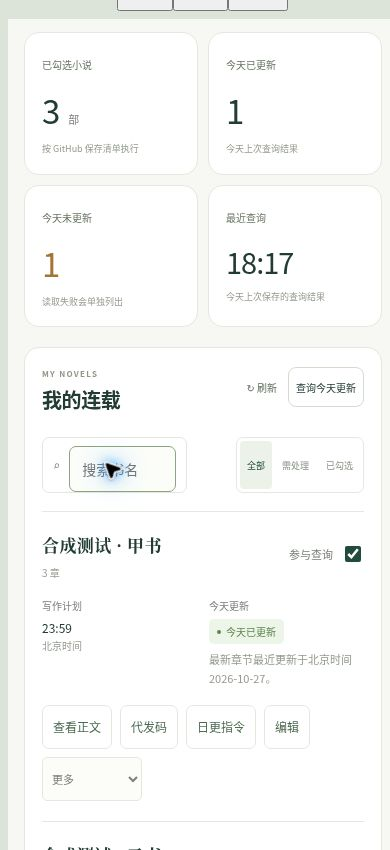

# 工作台1.3最终复查

复查日期：2026年10月27日（北京时间）。写作内核仍为4.3-quality，网页为1.3.0。代码基线为[b1ad62dec3fa88d44d0876b9b054736cfebaff7f](https://github.com/1464356758/xiaishuo-ZUOZONG/commit/b1ad62dec3fa88d44d0876b9b054736cfebaff7f)，本轮保留后续13b3d2c评估报告及原有小说清单。仅维护系统、指令、文档和空交付包，不修改正式小说、写作状态或平台回执。

## 修复与保留

- 日更恢复：旧active已标完成但回执丢失时，原来可能直接启动下一章。现在验证执行身份、目标、日期绑定及回执路径，先恢复原目标的回执；不会把昨天采用改记今天，也不清零修订次数。另处理回执先保存而active尚未更新的中断，恢复完成状态后第二天可正常推进。未知状态或串书记录停止执行。
- 写作要求：复用每书唯一实际任务，读近期正文、事实与开放承诺，先任务书和场景预算，再完整一章、正文反向核对、相似桥段比较及带引文审读。最多三轮局部修订；远端先保存执行记录，完成时再原子提交并回读。提示词不能证明实际模型或思考档位。
- 个人端：手机列表改为卡片，常用按钮无需横滑，六个导航均可见。按小说身份与实际分支记住最后核验通过的阅读章号。Git版本发现保留真实默认分支名，默认分支与显式选择同名分支共用进度，默认分支切换时隔离旧进度。整本导出固定来源提交，禁止同书重复启动；切书或刷新取消旧导出，旧请求不影响新书按钮。
- 代发端：复制开始前固定正文、章号与哈希，避免异步期间切章记错进度。进度按仓库、分支、作品隔离；已复制章内容改变时建议重新检查该章，最后一章不会回跳第一章。
- 发布状态：复用state中已有发布登记，两端展示与当前章哈希相符的记录；缺少登记只说“尚未登记”，不推断平台未发布。复制和导出均不会自动登记发布，不另建一套回执系统。
- 执行核验：日更页新增只读“核验本日完成证据”，独立核对正式正文、冻结、审查和完成回执。running只是仓库记录，不能证明任务存活；缺失回执要求恢复，读取失败单列。
- 反馈与同步：可登记固定任务反馈链接，优先打开实际反馈对话。链接不改变平台投递位置；生成指令不等于建立任务。查询范围变化或查询未完成时不当作新鲜结果，按已回读的清单确认“已同步”，同步设置提示随真实保存状态更新。

**日常查询口径保持不变：最新正式章节文件最近一次提交的北京时间日期为今天，就算今天更新。** 同章修改可计入，只改配置不计入；全部勾选书立即查询，不增加日报、计划时间或完成回执门槛。正式写作完成与平台发布另行核对。

## 验证记录

本节记录本轮实际验证；1.2与1.2.1历史记录仍保存在《工作台1.2修复验证.md》，不冒充本轮重测。浏览器使用明确合成小说和模拟接口，生产站点验证另行区分。

- Python全套145项通过，JavaScript全套139项通过。新增案例覆盖完成回执丢失、昨日恢复、路径和作品绑定、复制切章、分支进度隔离、导出取消、可选执行核验和发布版本不符。
- 浏览器在390px与320px的实际iframe中操作个人端，页面内容宽度分别为375px与305px（扣除滚动条），没有水平溢出；六个导航和卡片常用操作可见。已操作查询三种结果、换书生成指令、独立核验中断、刷新继续已读第3章和整本导出。合成导出实际生成765字、3章的Blob。
- 代发端在桌面及390px iframe操作了代发码读取、正文核验、复制进度、刷新建议下一章、TXT导出和无效码失败提示。TXT合成导出实际生成250字、1章Blob。没有调用平台投稿。
- 合成同步接口使用明确测试字符串，实际触发一次清单保存并回读，刷新仍能恢复已保存查询。未在浏览器输入作者的真实GitHub凭证，不能把模拟接口当成本轮真实写入授权验收。
- 指令预览的时间、仓库和防跳步要求已核对，复制按钮返回成功；本轮浏览器工具的虚拟剪贴板无法回读网页原生剪贴板，实际粘贴未完成重测。下载Blob已观察到，浏览器下载事件取路径超时，不宣称已核对系统下载目录。
- 生产版本的实际提交、打包哈希、部署状态和上线回读另以本次交付运行记录为准。GitHub源码与部署需要分别核对，不能由本地测试推定线上成功。

## 最终使用边界

当前Sites访问配置经本轮读取仍为仅所有者，代发页与个人页同站，不能宣称合作人独立访问已通过。本轮保留原访问范围。需要真实合作人使用时，须由作者另行明确授权访问方案并从对方账号验收。

本轮不创建或修改实际ChatGPT任务，不创作章节、不投稿。完整自动续章、七天连续运行、跨工作区停止与恢复、多书并行，以及合作人跨设备实际发布仍待生产验收。先一本连续七天核对目标、提交、回读与人工介入，再两本隔离运行一周，无串书、重复、跳章后才逐步增加。程序测试不证明文学质量、签约收益或十本长期无人值守；也不证明返回创建任务的原对话。
