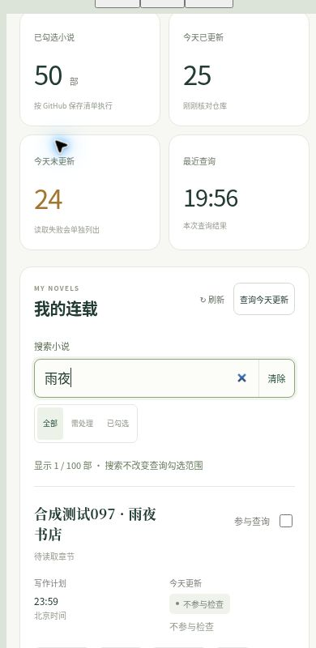

# 工作台1.4搜索

日期：2026年10月27日。源版本：fbc020957446e6177881f15ecb611ba38b41eaf2。仅补充检索与选择交互，写作内核仍为4.3-quality。

## 可以在哪里查找

- 我的小说：搜索书名或GitHub仓库关键词，可与“全部／需处理／已勾选”筛选一起使用。显示匹配数与总数，无匹配时可一键清除搜索和筛选。
- 日更、阅读、代发选书：都有独立搜索框，输入关键词后从匹配结果中选择。选项同时显示书名与仓库名，避免同名书混淆；没有匹配时不自动选择另一部小说。
- 个人端与代发端章节目录：支持章号、章节标题和多个关键词。22、０２２、第22章或第 022 章精确定位第22章；搜索2不会混入20至29章。选中后仍按正式正文哈希核验。
- 今日更新结果：按书名或仓库筛选已取得的结果；显示匹配条数，导出始终保留该次全部查询。

兼容中文输入法、英文大小写和全角字符；空格分隔的多个关键词同时匹配。可点击“清除”恢复，也支持电脑Esc清除。不同页面的搜索互不覆盖。

搜索范围是已经加入的小说，以及当前书的正式目录。它只改变显示，不改变小说勾选、任务、同步内容或写作状态。今日更新仍检查全部已勾选书，沿用最新正式章节文件北京时间提交日期的规则。搜索框内输入不会触发正文批量下载。

## 验证

- 本轮Python全套146项、JavaScript全套146项通过；独立包检查覆盖每个相对模块依赖，避免搜索模块漏打包。
- 浏览器使用明确合成的100本小说，其中一本含100章。已操作全角仓库关键词、书名、多入口选书、无匹配提示、清除恢复、章号精确定位和代发端标题搜索。
- 390px与320px iframe验证无水平溢出。选书后状态、刷新按钮和指令对应当前书；搜索框回车不触发指令表单提交。
- 列表只显示1本时，实际查询仍包含50本已勾选书；结果筛选为1条后导出Blob仍含50条。查询过程中禁止导出半成品，完成后恢复导出。
- 模拟接口写入次数为0，搜索测试没有更改作者正式小说清单、章节或写作状态。生产部署、源码回读另以本次交付记录为准，不把合成数据验证说成100本真实生产。

